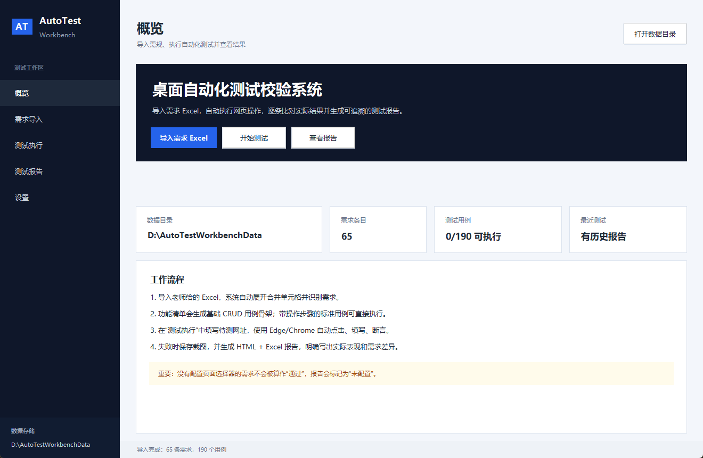
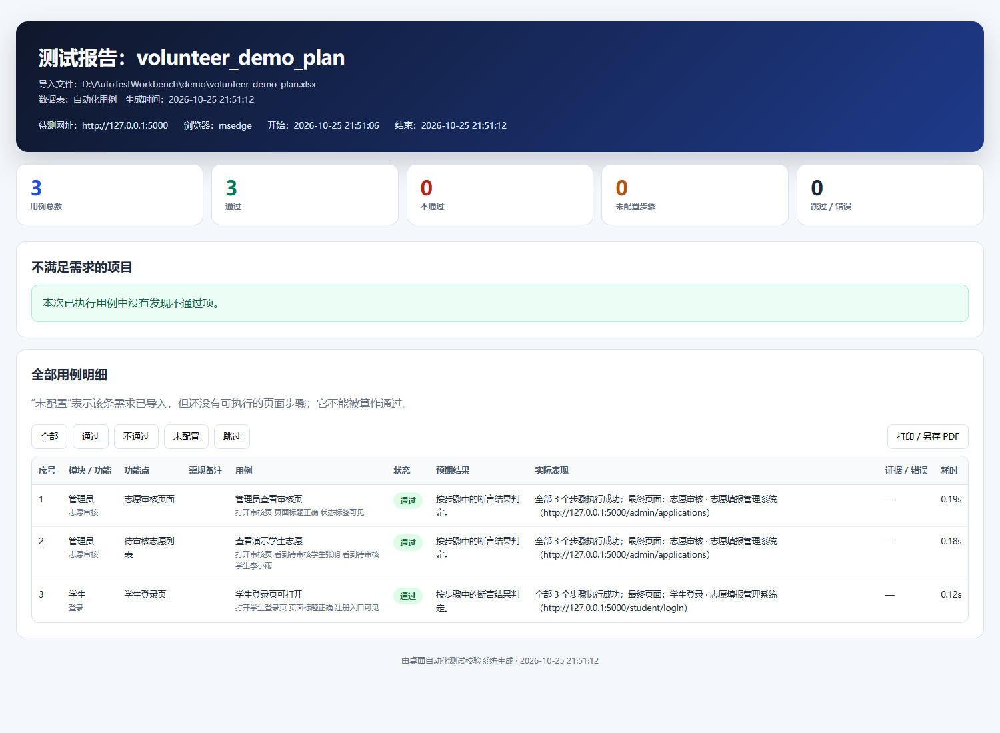

# AutoTest Workbench

一个免安装的 Windows 桌面自动化测试校验工具：用本机 Edge / Chrome 自动执行网页测试，逐条记录预期结果、实际表现、通过 / 不通过状态和失败截图，最终生成 HTML + Excel 报告。

## 解决什么问题

验收测试里最耗时的不是「点」，而是「对着功能清单一条条写用例、一条条记录结果、再整理成报告」。本工具把这段流程自动化：导入 Excel 功能清单 / 标准用例 → 自动生成用例骨架 → 用 Playwright 执行 → 自动出报告。

## 已实现

- **导入需规 Excel**：自动展开合并单元格、自动识别需规工作表（支持标准用例、验收/测试用例、功能需求、功能清单四类表头）
  - 3000 条需规导入约 **0.2 秒**；界面只预览前 1500 条，项目和报告保留全部
  - 没有页面步骤的需求会明确标记为「未配置」，**不会伪造通过**
- **自动提取测试账号与权限**：支持账号/密码/角色/权限矩阵，步骤里用 `{{username}}` / `{{password}}` 占位符，执行时自动注入
- **Playwright 执行引擎**：19 类操作与断言（打开/点击/填写/选择/按键/等待/文本断言/元素可见/网址断言/数量断言/排序断言/去重断言/属性断言/值断言/隐藏断言/媒体切换/刷新/截图）
- **失败自动截图**，生成 HTML + Excel 双格式报告
- **桌面 GUI**：左侧测试向导（1 导入需规 → 2 软件网址与账号 → 3 开始测试）、用例步骤编辑器、执行进度、历史报告
- **免安装打包**：PyInstaller 便携版，最终用户不需要装 Python / Node

## 实测结果

- 志愿星图 V2.0：**15 条验收用例，14 条自动通过**，1 条桌面快捷方式保留为未配置
- 老师提供的 ERP 功能清单：**65 条需求 → 190 个基础 CRUD 用例骨架**
- 可编辑测试计划导出 / 重导入：65 条需求、190 个用例、3 条备注、原始序号全部保持
- 故意错误的断言：成功识别为不通过并保存失败截图
- 打包后 exe 自检通过（存储、Excel 模板、Excel 导入、网页执行、报告生成）

## 界面




## 快速开始

```powershell
cd AutoTestWorkbench
python -m venv .venv
.\.venv\Scripts\python.exe -m pip install -r requirements.txt
.\.venv\Scripts\python.exe app.py
```

自检：

```powershell
.\.venv\Scripts\python.exe app.py --self-test
```

打包：

```powershell
.\.venv\Scripts\python.exe -m pip install -r requirements-build.txt
powershell -ExecutionPolicy Bypass -File .\build.ps1
```

## 技术栈

Python · Tkinter · Playwright · openpyxl · PyInstaller

## 重要边界

老师给的 Excel 是**功能清单**（65 条需求），但没有每一步的操作方式、页面元素和预期结果。因此：

- 系统可以完整导入并生成 190 个用例骨架；
- 但在没有 ERP 测试账号、无法访问内网、没有页面选择器的情况下，不能真实执行并断言这 190 个用例；
- 报告会把这些项目标为「未配置」，并列出 Excel 中已有的需规备注（如「无法正常生成服务工单」）。

**宁可标「未配置」，也不伪造「通过」**——测试结论必须可审计。
